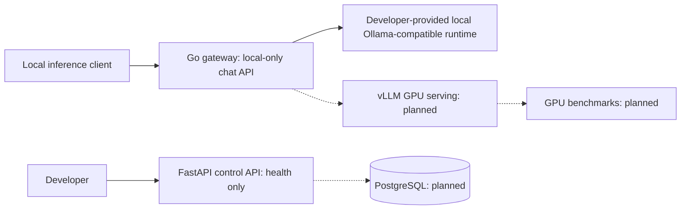

# Metriqen

**LLM Serving & Inference Optimization Platform**

Metriqen is an engineering project focused on deploying open-weight language models under concurrent traffic, then testing quantization, batching, and GPU-memory strategies against an objective baseline.

**Status: local inference and offline-verified benchmarking tooling.** The Go gateway provides a tested local-only OpenAI-compatible inference bridge (including streaming); a Python CLI now records reproducible local load-test observations. No real Ollama/vLLM model run, GPU benchmarking, NLP quality measurement on a real model or optimization improvement has been verified. Authentication policy and OIDC verification remain standalone libraries, not connected to HTTP inference routes.

## Problem and research goal

Throughput, time to first token (TTFT), p95 latency, GPU memory, and serving cost change with workload concurrency and model/runtime configuration. Our objective is to **measure before and after performance at comparable output quality**, not claim unverified gains.

## Implemented

- FastAPI control service: `GET /health/live` and `GET /health/ready`.
- Go gateway process: matching health endpoints and graceful shutdown.
- Unit tests for both services; Go tests run with the race detector.
- Docker Compose configuration that only binds host ports to loopback.
- CI workflow for Python and Go tests.
- Tenant-scoped authorization policy and negative permission tests (not yet wired into APIs).
- OIDC RS256 claim verification and trusted in-memory JWKS key selection tests (no live identity provider).
- Local-only Go `POST /v1/chat/completions` forwarding to a configured local OpenAI-compatible runtime, including SSE flush, input limits, concurrency backpressure and cancellation (tested with loopback HTTP mocks).
- A dependency-free local benchmark runner for streamed TTFT, p95 latency, successful throughput, error rates and optional token usage. Offline and cross-service (Go gateway + Python runner + fixture upstream) tests; **no real model benchmark results yet**.
- NLP evaluation CLI for exact/normalized matching on ID-aligned JSONL, plus a localhost-only tool that obtains model predictions and scores references in memory. Verified with mock responses, not with a real model; no semantic or hallucination grading claimed.

**Not implemented:** user/admin login, enforced RBAC or API-key authentication on inference, identity-provider discovery, verified real-model generation, vLLM GPU serving, executed real-model load benchmarks, quantization, optimization UI, or production deployment. Readiness currently checks the processes only. **Do not expose inference publicly.**

## Develop locally

Prerequisites: Python 3.12+, Go 1.23+ (CI uses Go 1.27.2). Docker is optional.

Control API:

1. `cd services/control-api`
2. `python -m pip install -e '.[dev]'`
3. `uvicorn app.main:app --host 127.0.0.1 --port 8000`

Gateway (in another terminal):

1. `cd services/inference-gateway`
2. `go run ./cmd/server` (health-only default). To connect local Ollama: `METRIQEN_UPSTREAM_URL=http://127.0.0.1:11434 go run ./cmd/server`. See [local inference guide](docs/operations/local-inference.md) for prerequisites, curl commands and security limitations.

From the repository root, run `make test` after installing Python development dependencies. This runs the control API, Go gateway, cross-service E2E, benchmark, and NLP suites. To check local benchmark evidence consistency, use `python -m tools.benchmark.evidence_gate path/to/manifest.json --verify-reports`; the check does not establish actual model execution.

With Docker Engine, use `docker compose up --build` for local-only HTTP services. Docker operation must still be verified in an environment with an active Docker daemon.

## Architecture and roadmap

Solid lines are current interfaces; dashed lines are planned components.

See [real-model baseline protocol](docs/operations/real-model-baseline.md), [NLP evaluation guide](docs/nlp-eval/README.md), [end-to-end verification guide](docs/operations/e2e-contract-validation.md), [requirements](docs/product/PRD.md), [roadmap](ROADMAP.md), [security policy](SECURITY.md), [local inference guide](docs/operations/local-inference.md), [local benchmark guide](docs/benchmarks/local-load-testing.md), and [ADR-0004](docs/architecture/adr/0004-local-inference-bridge.md).

## Measurement standards

Every future experiment must record model revision, hardware/VRAM, precision, runtime version, traffic profile, prompt/output lengths, warm-up, concurrency, failures, and quality-evaluation methodology. Report actual measured results only.

## License

No open-source license has been selected yet. A public repository without a license does not grant general reuse rights.
