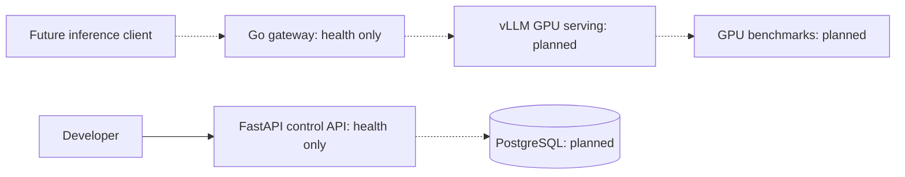

# Metriqen

**LLM Serving & Inference Optimization Platform**

Metriqen is an engineering project focused on deploying open-weight language models under concurrent traffic, then testing quantization, batching, and GPU-memory strategies against an objective baseline.

**Status: authentication/security foundation (in progress).** No LLM is deployed and no optimization measurements have been made. The repository has health-check services, a deny-by-default authorization policy and standalone signed-token/JWKS verification libraries. None of those security libraries is connected to an HTTP login or protected business route yet.

## Problem and research goal

Throughput, time to first token (TTFT), p95 latency, GPU memory, and serving cost change with workload concurrency and model/runtime configuration. Our objective is to **measure before and after performance at comparable output quality**, not claim unverified gains.

## Implemented

- FastAPI control service: `GET /health/live` and `GET /health/ready`.
- Go gateway process: matching health endpoints and graceful shutdown.
- Unit tests for both services; Go tests run with the race detector.
- Docker Compose configuration that only binds host ports to loopback.
- CI workflow for Python and Go tests.
- Tenant-scoped authorization policy and negative permission tests (not yet wired into APIs).
- OIDC RS256 claim verification and trusted in-memory JWKS key selection tests (no live identity provider).

**Not implemented:** user/admin login, enforced RBAC at HTTP routes, identity-provider discovery, inference API, vLLM integration, GPU serving, load benchmarking, quantization, optimization UI, or production deployment. Readiness currently checks the processes only.

## Develop locally

Prerequisites: Python 3.12+, Go 1.23+ (CI uses Go 1.27.2). Docker is optional.

Control API:

1. `cd services/control-api`
2. `python -m pip install -e '.[dev]'`
3. `uvicorn app.main:app --host 127.0.0.1 --port 8000`

Gateway (in another terminal):

1. `cd services/inference-gateway`
2. `go run ./cmd/server`

From the repository root, run `make test` after installing the Python development dependencies.

With Docker Engine, use `docker compose up --build` for local-only HTTP services. Docker operation must still be verified in an environment with an active Docker daemon.

## Architecture and roadmap

Solid lines are current interfaces; dashed lines are planned components.

See [requirements](docs/product/PRD.md), [roadmap](ROADMAP.md), [security policy](SECURITY.md), and [ADR-0003](docs/architecture/adr/0003-pinned-jwks-verification.md).

## Measurement standards

Every future experiment must record model revision, hardware/VRAM, precision, runtime version, traffic profile, prompt/output lengths, warm-up, concurrency, failures, and quality-evaluation methodology. Report actual measured results only.

## License

No open-source license has been selected yet. A public repository without a license does not grant general reuse rights.
