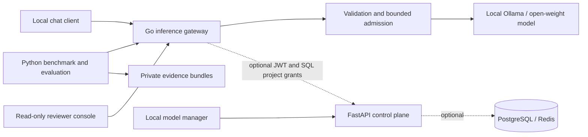

# Metriqen

**Local LLM inference gateway, admission scheduling, and reproducible serving experiments.**

[](https://github.com/naim-munshi/metriqen-llm-serving-optimization/actions/workflows/ci.yml)

**Engineering case study:** [architecture, implementation decisions, measured results and trade-offs](docs/PORTFOLIO_CASE_STUDY.md) · [Unreleased changelog](CHANGELOG.md)

**P1 deployment lifecycle acceptance:** [read-only preflight and explicit local Stop/Start/Promote/Rollback command](docs/operations/local-deployment-acceptance.md), with synthetic CI contract coverage. The operator has now reported real Mac Stop/Start/Promote/Rollback and matching private smoke/lifecycle consistency PASS, with genuine Safari snapshots of the final `assistant` routing state; private evidence remains unpublished and release/browser accessibility sign-off is still pending.

**Mac/operator final handoff:** [exact P1–P6 actions, recovery checks, screenshots, benchmark and release blockers](docs/operations/portfolio-final-mac-handoff.md). This is an operator checklist, not evidence that those tasks have already run.

**Portfolio v1.0 release criteria:** [six objective gates](docs/PORTFOLIO_V1_ACCEPTANCE.md) · [real local Ollama acceptance checker](docs/operations/real-ollama-portfolio-acceptance.md) · [three-console reviewer tour](docs/operations/portfolio-local-reviewer-journey.md). The existing [offline reviewer demo](docs/operations/offline-portfolio-demo.md) uses **synthetic** model replies; it is a CI contract test, not a real Ollama run. **Portfolio v1.0 is not released yet.**

Metriqen is an **engineering research prototype** for understanding how concurrent requests, serving configuration, and workload design affect open-weight language model performance. It combines a Go inference gateway with Python benchmarking, answer-reference evaluation, and evidence-validation tools.

**Current scope:** tested, **loopback-only** local inference with Ollama. Not a hosted API, a production service, a GPU batching engine, or a verified general-purpose inference optimizer.

## At a glance

| Area | Implemented today | Boundary |
| --- | --- | --- |
| **Serving** | Go `/v1/chat/completions` gateway, streaming SSE/nonstream JSON, bounded validation, cancellation and sanitized errors | Local upstream only; legacy developer mode may be **unguarded**; optional JWT/project checks are **not** production identity |
| **Admission control** | Four local active slots, opt-in FIFO waiting queue, Redis-backed project request quotas and in-flight leases, conservative output-cap reservations | Project guards must be explicitly enabled on all replicas; no continuous batching or GPU token-level scheduling |
| **Model management** | Operator-only local Ollama registry, digest approvals, preload/unload, named deployments/rollback; opt-in SQL deployment-ready project routing | Approval in operator UI does not itself block unguarded direct Go inference; runtime digest/tag races remain |
| **Measurement** | Versioned workloads, repeated sweeps, TTFT/p95/RPS, quality and evidence gates; aggregate provider-reported token counters | Mostly single-machine tests; provider usage is untrusted and **not billable**; no verified causal serving speedup |
| **Evaluation** | Exact/normalized reference-answer checks, matched evidence and A/B/A/B drift review | String matching is **not** semantic/factual quality evaluation |
| **Control plane / Accounts** | FastAPI pinned-JWKS access token validation, opt-in local OIDC browser sessions/Redis, PostgreSQL org/project RBAC and durable deployments | Requires operator-supplied IdP/config; no hosted production tenant service |
| **Reviewer interface** | Go read-only operations console + separate FastAPI model manager and optional OIDC account console, with fixed local navigation | Not one shared login/session; real Mac browser and accessibility/screenshots still unverified |

**Stack:** Go · Python · FastAPI · Ollama / llama.cpp · PostgreSQL / SQLAlchemy (optional) · Docker Compose (local) · GitHub Actions.

## System architecture



The Go gateway has an explicitly opt-in pinned-local Control API authorization seam that can check current JWT/SQL project permission and deployment-ready model identity, but **default unguarded local inference does not use it**. Dashed connections are opt-in, not a production security boundary. See [security constraints](SECURITY.md), [architecture decisions](docs/architecture/adr/), and [current engineering status](docs/PROJECT_STATUS.md).

## Reproducible evidence: an observed local experiment

The [October 13, 2026 case study](docs/benchmarks/experiments/2026-10-13-ollama-parallelism.md) compares the **Ollama setting** `OLLAMA_NUM_PARALLEL=1` with `2` (not a Metriqen scheduler optimization) for `llama3.2:1b` Q8_0 on a developer-operated Apple M2 with Metal.

| Offered concurrency | P=1 successful requests/s | P=2 successful requests/s | Observed change |
| ---: | ---: | ---: | ---: |
| 1 | 0.1566 | 0.1505 | −3.895% |
| 2 | 0.1811 | 0.2431 | **+34.235%** |
| 4 | 0.2101 | 0.2374 | +12.994% |

Each setting had 9 runs (3 repeats at concurrency 1/2/4), **324/324 measured requests succeeded**, and the separate 36-question reference checks produced **31/36 exact** and **33/36 normalized** matches in both settings.

**Interpretation:** these are sequential, operator-observed **descriptive** results. Concurrency 1 throughput regressed; the study was not randomized, raw files remain private, and CI cannot independently attest runtime slots or hardware. It establishes **neither a causal speedup nor a production performance claim**. Follow-up and newer private runs must not be conflated with the published October 13 comparison.

[Full experiment and methodological limits](docs/benchmarks/experiments/2026-10-13-ollama-parallelism.md) · [Versioned performance workload](docs/benchmarks/workload.v1.jsonl) · [Versioned quality workload](docs/nlp-eval/workload.v1.jsonl) · [Benchmark protocols](docs/benchmarks/repeated-sweep.md)

**Faster prospective P2 operator workflow:** [guarded single-phase collection and finalization](docs/benchmarks/phase-runner.md) generates a fresh AC/pinned-runtime preflight, nine actual concurrency runs and 36 reference-quality samples per manually configured A1/B1/A2/B2 phase, followed by explicit operator-reviewed evidence finalization. Nothing runs automatically in GitHub CI on the Mac; no full new four-phase study has been claimed.

**Next experimental protocol (not performance evidence):** the [FIFO admission overload comparison](docs/benchmarks/admission-overload.md) uses an independent local-only runner to record all successful and rejected requests at offered concurrency 4/6/8/12, plus process-local admission counter deltas, for queue depth 0 versus 2. This has **no published real-model scheduler benefit**; it does not modify the October 13 Ollama parallelism results or their historical private evidence.

## P1 portfolio acceptance evidence (operator-run)

Once the actual Mac has completed the native Ollama/Go smoke and full
Stop/Start/Promote/Rollback lifecycle, use the [offline cross-report
consistency checker](docs/operations/p1-evidence-review.md) to produce a
private, sanitized review. Its result is **not** proof of GPU execution or
completion of P1, P2 or P3; independently reviewed browser evidence is
still required.

## Local deployment routes (opt-in)

The operator Model Manager now supports **persistent named local deployment
aliases** backed by SQLite. An approved, preloaded revision can be assigned
to a stable inference route, promoted to another approved revision, paused,
resumed and rolled back one step. The browser includes deployment controls
and a stable-name inference playground. This is **real local routing** but
**not** GPU worker provisioning, autoscaling, public authentication or
production deployment. [Operator contract and limits](docs/operations/local-deployments.md).

## Local inference monitoring (opt-in)

The Model Manager includes **Gateway Monitoring** with actual process-local inference,
queue and upstream-failure counters fetched from fixed loopback Go endpoints
through the protected FastAPI control API. Metrics refresh in the visible
connected browser and never log prompts. Counters reset when Go restarts;
mean post-admission duration is NOT p95, TTFT, throughput or an optimization
claim. [Monitoring runbook](docs/operations/local-inference-monitoring.md).

## Local model manager and Ollama lifecycle (opt-in)

An operator-only control API slice now discovers **installed** Ollama models, persistently registers their actual SHA-256 digests in private local SQLite, approves revisions, requests a five-minute **preload**, verifies the loaded-model identity, and can unload the matching approved model. A **responsive local Model Manager UI** at `http://127.0.0.1:8000/console/models` supports this workflow from a browser and includes a **single-turn inference playground** which checks registry approval, installed/loaded model digest, and forwards through the local Go gateway. It uses a memory-only local operator token. It is **disabled by default** and requires a separate local bearer secret; the Go inference route does **not** enforce registry approval yet. This is a functional *local model management* step, not a GPU deployment orchestrator or serving optimization. [Instructions and limits](docs/operations/local-model-registry.md).

## Real PostgreSQL tenant-authorization CI

A dedicated GitHub Actions job exercises the **checked-in PostgreSQL
migration** on a disposable PostgreSQL 16 service and tests JWT-authorized
project access, cross-organization constraints and grant revocation.
This complements the existing SQLite contract fixtures; no PostgreSQL
server is required on your Mac for the offline portfolio demo.
[Exact CI evidence boundaries](docs/operations/postgres-ci.md).

## One-command offline portfolio demo

Review Metriqen's **real Go gateway** without installing Ollama, downloading a model, or providing an API key. From the repository root (Go 1.23+, Python 3.12+):

```bash
python3 -m tools.demo.offline
```

The demo builds the gateway, starts a deterministic synthetic HTTP upstream on **loopback only**, verifies non-streaming chat, SSE streaming, model filtering, upstream failure metrics, a bounded 4-active/2-waiting queue, overload HTTP 429, safe queue handoff and valid-versus-truncated SSE terminal markers, then shuts down both temporary services. It prints machine-readable JSON with **18 contract checks** and explicit `model_inference_executed: false` / `performance_measurement: false`. This is a software-behavior demo, **not** an LLM speedup or model-quality benchmark. It does not interfere with an existing Ollama instance or the main gateway.

[Demo procedure, precise checks and limits](docs/operations/offline-portfolio-demo.md) · [Existing Go + Python synthetic E2E tests](docs/operations/e2e-contract-validation.md)

## Read-only Local Operations Dashboard

With the inference gateway running on loopback, open **http://127.0.0.1:8081/console** in a browser. The embedded, responsive dashboard displays gateway and Ollama API health, FIFO capacity, inference outcome counters, categorized upstream failures, and a clearly labeled mean post-admission handler duration from existing read-only endpoints. It uses **no Node runtime, CDN or external analytics**; it does not generate text or modify inference scheduling.

It is an **unauthenticated read-only local development console**, even when optional bearer protection is enabled for the chat route. This is not a secure production deployment or an LLM-performance measurement. The dashboard is not registered in health-only deployments. [Runbook and limits](docs/operations/local-console.md).

## Optional local inference bearer protection

For extra defense-in-depth on loopback, set `METRIQEN_GATEWAY_BEARER_TOKEN`
to an operator-managed random secret of 32–256 printable ASCII bytes.
Only `POST /v1/chat/completions` then requires
`Authorization: Bearer <token>`; wrong or missing credentials fail
before admission or prompt forwarding. The option is **off by default**,
and the dashboard/health/metrics remain unauthenticated and local-only.
This is **not** integrated JWT/RBAC or permission to expose the service.

[Local shared-secret configuration and limits](docs/operations/local-bearer-token.md)

## Quickstart — local inference

**Requirements:** Go 1.23+; locally installed [Ollama](https://ollama.com/) with `llama3.2:1b` pulled. Python 3.12+ is used for analysis and tests. All traffic must remain on localhost.

1. Ensure one local Ollama instance is running on `127.0.0.1:11434`. For example, pull the model with `ollama pull llama3.2:1b`; do not start a second instance if Ollama is already running.
2. In a separate terminal, start the Go gateway:

   ```bash
   cd services/inference-gateway
   METRIQEN_UPSTREAM_URL=http://127.0.0.1:11434 go run ./cmd/server
   ```

3. From another terminal, verify health and a non-streaming completion:

   ```bash
   curl -fsS http://127.0.0.1:8081/health/live

   curl -fsS http://127.0.0.1:8081/v1/chat/completions \
     -H 'Content-Type: application/json' \
     -d '{"model":"llama3.2:1b","messages":[{"role":"user","content":"Define time to first token in one sentence."}],"temperature":0,"max_tokens":64,"stream":false}'
   ```

For streaming SSE, opt-in `METRIQEN_ALLOWED_MODELS`, or the **experimental FIFO queue** `METRIQEN_QUEUE_DEPTH`, follow the [local inference runbook](docs/operations/local-inference.md). The queue is **disabled by default**, keeping the baseline gateway's immediate HTTP 429 overload behavior. Enabling the queue changes the experimental configuration.

## Tests and repository layout

From the repository root, after installing the Python control API development dependencies (see [CONTRIBUTING.md](CONTRIBUTING.md)):

```bash
make test
```

CI separately runs Python control API, **an isolated PostgreSQL 16 migration-backed integration job**, Go race-enabled and vet, cross-service E2E, benchmark contract, and NLP evaluator tests. **CI uses synthetic/loopback fixtures, not the developer's private Mac inference reports.**

```text
services/control-api/       FastAPI control plane, identity and RBAC seams
services/inference-gateway/ Go chat gateway and admission scheduler
tools/benchmark/            Sweeps, evidence validation and drift review
tools/nlp_eval/             Reference scoring and local quality runner
docs/architecture/adr/      Architecture decision records
docs/benchmarks/            Workloads, experiment protocols, case study
docs/operations/            Local inference and validation runbooks
tests/e2e/                  Go gateway + Python client integration tests
```

**Reviewer briefing:** [Engineering portfolio, runnable demo and interview discussion](docs/PORTFOLIO.md).

**Read next:** [Project scope and verification matrix](docs/PROJECT_STATUS.md) · [Architecture decisions](docs/architecture/adr/) · [Roadmap](ROADMAP.md) · [Contributor workflow](CONTRIBUTING.md) · [Repository maintenance](docs/REPOSITORY_MAINTENANCE.md) · [Security](SECURITY.md).

## Security, limitations and license

- **Development-only:** legacy local inference can be unauthenticated; an optional separate local bearer token and opt-in JWT/project guards exist but do not provide production-grade identity, tenant isolation, security audit or TLS termination. **Do not expose it publicly.**
- The current implementation does **not** include vLLM GPU serving, production deployment, optimized GPU memory scheduling, cost accounting, model training, or validated throughput improvements caused by Metriqen's new FIFO queue.
- Benchmark reports and prompt/response artifacts under `reports/local/` are intentionally Git-ignored. Human-attested evidence does not cryptographically prove execution.
- **License:** no open-source license has been selected. Source visibility does not grant a general right to use, modify or redistribute this repository. See [CONTRIBUTING.md](CONTRIBUTING.md).

**Maintainer:** [Md Naim](https://github.com/naim-munshi) · Tokyo Polytechnic University, Faculty of Engineering.

## Identity, user data, Redis and load balancing

A verified OIDC access token can now create/read/update **only its own** PostgreSQL-backed profile through `/api/v1/me` when the local IdP verifier and DB have been explicitly configured and migrated. The `/api/v1/me` token-authenticated route is **not itself** a browser sign-in implementation; a separate opt-in browser OIDC login now exists, but it has not passed real-provider operator acceptance. The local Model Manager operator token does not authenticate user profiles. See the [account runbook](docs/operations/verified-user-profiles.md) and [target architecture and security review](docs/architecture/identity-data-redis-load-balancing.md). An optional **Redis Lua-backed account-write quota** (20 operations/minute-ish first-hit window per verified identity) is implemented but requires a separately operated authenticated loopback Redis server and remains unverified against live Redis. An **opt-in loopback OIDC Authorization Code + PKCE browser login/logout and Redis session flow** is now implemented, with a PostgreSQL-backed My Account page, state/nonce verification and CSRF on writes. No external IdP is configured or live-verified, and production HTTPS/Secure cookie conversion is outstanding. See the [browser login runbook](docs/operations/browser-oidc-login.md). GPU workers and production load-balanced serving remain planned.

## Optional loopback HAProxy gateway replicas

A **local-only** HAProxy configuration now demonstrates least-connection routing across two Go inference gateway processes (ports 8081 and 8082), exposing only `POST /v1/chat/completions` on 127.0.0.1:8090. The Model Manager may select this **fixed, operator-configured** local listener with `METRIQEN_LOCAL_CHAT_GATEWAY_PORT=8090`; no client-chosen upstream URL is accepted. [Operator setup and security limitations](docs/operations/local-ha-proxy.md). This is **not** a production load balancer, verified SSE performance gain, multi-tenant gateway authorization or increased Ollama GPU capacity.

## Organization and project data management (OIDC + PostgreSQL)

Verified JWT users and signed-in browser sessions can now **create organizations, list only their own memberships, create projects under authorized organizations and list only projects visible through PostgreSQL grants**. New organization and creator-owner membership insert in one transaction. The My Account portal offers organization/project creation and project browsing; browser writes require CSRF. No self-assigned roles, caller-selected organization IDs or JWT permission claims are trusted. This is **local opt-in data CRUD**, not tenant administration, invites or authorized gateway access. [Data management runbook](docs/operations/workspace-data-management.md).
