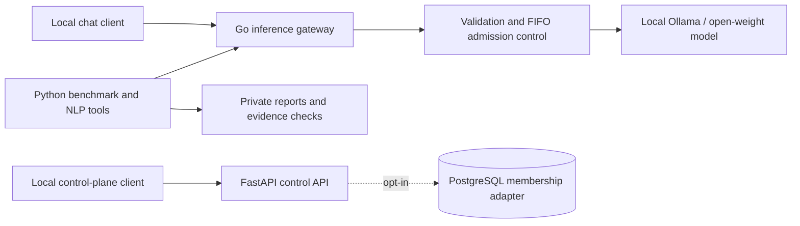

# Metriqen

**Local LLM inference gateway, admission scheduling, and reproducible serving experiments.**

[](https://github.com/naim-munshi/metriqen-llm-serving-optimization/actions/workflows/ci.yml)

Metriqen is an **engineering research prototype** for understanding how concurrent requests, serving configuration, and workload design affect open-weight language model performance. It combines a Go inference gateway with Python benchmarking, answer-reference evaluation, and evidence-validation tools.

**Current scope:** tested, **loopback-only** local inference with Ollama. Not a hosted API, a production service, a GPU batching engine, or a verified general-purpose inference optimizer.

## At a glance

| Area | Implemented today | Boundary |
| --- | --- | --- |
| **Serving** | Go `/v1/chat/completions` gateway; streaming SSE and non-streaming JSON; bounded validation, cancellation and sanitized errors | Local upstream only; optional static **loopback bearer token** on chat requests, not production identity |
| **Admission control** | Four active gateway requests; opt-in FIFO wait queue (depth 0–32), wait timeout, backpressure and versioned `GET /metrics/admission` diagnostics and independent `GET /metrics/inference` outcome counters with fixed queue-wait duration buckets; optional exact model-tag allowlist | No continuous batching, model-digest enforcement or tenant-level scheduling |
| **Measurement** | Versioned workloads, repeated rotating-order sweeps, TTFT, latency, throughput, token-usage coverage and run-timing diagnostics | Primarily single-machine local experiments |
| **Evaluation** | Separate exact and normalized answer-reference checks; matched-report comparison, evidence bundles and A/B/A/B drift-review tooling | String matching is **not** semantic/factual quality evaluation |
| **Control plane** | FastAPI health routes, pinned-JWKS access-token boundary, trusted project-read RBAC seam and optional local PostgreSQL adapter | No integrated production login, tenant API keys, PostgreSQL deployment or real IdP |

**Stack:** Go · Python · FastAPI · Ollama / llama.cpp · PostgreSQL / SQLAlchemy (optional) · Docker Compose (local) · GitHub Actions.

## System architecture



The inference route is **not** protected by the control-plane identity code. Dashed infrastructure is opt-in and not part of a production deployment. See [architecture decisions](docs/architecture/adr/) and [current engineering status](docs/PROJECT_STATUS.md).

## Reproducible evidence: an observed local experiment

The [October 13, 2026 case study](docs/benchmarks/experiments/2026-10-13-ollama-parallelism.md) compares the **Ollama setting** `OLLAMA_NUM_PARALLEL=1` with `2` (not a Metriqen scheduler optimization) for `llama3.2:1b` Q8_0 on a developer-operated Apple M2 with Metal.

| Offered concurrency | P=1 successful requests/s | P=2 successful requests/s | Observed change |
| ---: | ---: | ---: | ---: |
| 1 | 0.1566 | 0.1505 | −3.895% |
| 2 | 0.1811 | 0.2431 | **+34.235%** |
| 4 | 0.2101 | 0.2374 | +12.994% |

Each setting had 9 runs (3 repeats at concurrency 1/2/4), **324/324 measured requests succeeded**, and the separate 36-question reference checks produced **31/36 exact** and **33/36 normalized** matches in both settings.

**Interpretation:** these are sequential, operator-observed **descriptive** results. Concurrency 1 throughput regressed; the study was not randomized, raw files remain private, and CI cannot independently attest runtime slots or hardware. It establishes **neither a causal speedup nor a production performance claim**. Follow-up and newer private runs must not be conflated with the published October 13 comparison.

[Full experiment and methodological limits](docs/benchmarks/experiments/2026-10-13-ollama-parallelism.md) · [Versioned performance workload](docs/benchmarks/workload.v1.jsonl) · [Versioned quality workload](docs/nlp-eval/workload.v1.jsonl) · [Benchmark protocols](docs/benchmarks/repeated-sweep.md)

## Real PostgreSQL tenant-authorization CI

A dedicated GitHub Actions job exercises the **checked-in PostgreSQL
migration** on a disposable PostgreSQL 16 service and tests JWT-authorized
project access, cross-organization constraints and grant revocation.
This complements the existing SQLite contract fixtures; no PostgreSQL
server is required on your Mac for the offline portfolio demo.
[Exact CI evidence boundaries](docs/operations/postgres-ci.md).

## One-command offline portfolio demo

Review Metriqen's **real Go gateway** without installing Ollama, downloading a model, or providing an API key. From the repository root (Go 1.23+, Python 3.12+):

```bash
python3 -m tools.demo.offline
```

The demo builds the gateway, starts a deterministic synthetic HTTP upstream on **loopback only**, verifies non-streaming chat, SSE streaming, model filtering, upstream failure metrics, a bounded 4-active/2-waiting queue, overload HTTP 429, safe queue handoff and valid-versus-truncated SSE terminal markers, then shuts down both temporary services. It prints machine-readable JSON with **18 contract checks** and explicit `model_inference_executed: false` / `performance_measurement: false`. This is a software-behavior demo, **not** an LLM speedup or model-quality benchmark. It does not interfere with an existing Ollama instance or the main gateway.

[Demo procedure, precise checks and limits](docs/operations/offline-portfolio-demo.md) · [Existing Go + Python synthetic E2E tests](docs/operations/e2e-contract-validation.md)

## Read-only Local Operations Dashboard

With the inference gateway running on loopback, open **http://127.0.0.1:8081/console** in a browser. The embedded, responsive dashboard displays gateway and Ollama API health, FIFO capacity, inference outcome counters, categorized upstream failures, and a clearly labeled mean post-admission handler duration from existing read-only endpoints. It uses **no Node runtime, CDN or external analytics**; it does not generate text or modify inference scheduling.

It is an **unauthenticated read-only local development console**, even when optional bearer protection is enabled for the chat route. This is not a secure production deployment or an LLM-performance measurement. The dashboard is not registered in health-only deployments. [Runbook and limits](docs/operations/local-console.md).

## Optional local inference bearer protection

For extra defense-in-depth on loopback, set `METRIQEN_GATEWAY_BEARER_TOKEN`
to an operator-managed random secret of 32–256 printable ASCII bytes.
Only `POST /v1/chat/completions` then requires
`Authorization: Bearer <token>`; wrong or missing credentials fail
before admission or prompt forwarding. The option is **off by default**,
and the dashboard/health/metrics remain unauthenticated and local-only.
This is **not** integrated JWT/RBAC or permission to expose the service.

[Local shared-secret configuration and limits](docs/operations/local-bearer-token.md)

## Quickstart — local inference

**Requirements:** Go 1.23+; locally installed [Ollama](https://ollama.com/) with `llama3.2:1b` pulled. Python 3.12+ is used for analysis and tests. All traffic must remain on localhost.

1. Ensure one local Ollama instance is running on `127.0.0.1:11434`. For example, pull the model with `ollama pull llama3.2:1b`; do not start a second instance if Ollama is already running.
2. In a separate terminal, start the Go gateway:

   ```bash
   cd services/inference-gateway
   METRIQEN_UPSTREAM_URL=http://127.0.0.1:11434 go run ./cmd/server
   ```

3. From another terminal, verify health and a non-streaming completion:

   ```bash
   curl -fsS http://127.0.0.1:8081/health/live

   curl -fsS http://127.0.0.1:8081/v1/chat/completions \
     -H 'Content-Type: application/json' \
     -d '{"model":"llama3.2:1b","messages":[{"role":"user","content":"Define time to first token in one sentence."}],"temperature":0,"max_tokens":64,"stream":false}'
   ```

For streaming SSE, opt-in `METRIQEN_ALLOWED_MODELS`, or the **experimental FIFO queue** `METRIQEN_QUEUE_DEPTH`, follow the [local inference runbook](docs/operations/local-inference.md). The queue is **disabled by default**, keeping the baseline gateway's immediate HTTP 429 overload behavior. Enabling the queue changes the experimental configuration.

## Tests and repository layout

From the repository root, after installing the Python control API development dependencies (see [CONTRIBUTING.md](CONTRIBUTING.md)):

```bash
make test
```

CI separately runs Python control API, **an isolated PostgreSQL 16 migration-backed integration job**, Go race-enabled and vet, cross-service E2E, benchmark contract, and NLP evaluator tests. **CI uses synthetic/loopback fixtures, not the developer's private Mac inference reports.**

```text
services/control-api/       FastAPI control plane, identity and RBAC seams
services/inference-gateway/ Go chat gateway and admission scheduler
tools/benchmark/            Sweeps, evidence validation and drift review
tools/nlp_eval/             Reference scoring and local quality runner
docs/architecture/adr/      Architecture decision records
docs/benchmarks/            Workloads, experiment protocols, case study
docs/operations/            Local inference and validation runbooks
tests/e2e/                  Go gateway + Python client integration tests
```

**Reviewer briefing:** [Engineering portfolio, runnable demo and interview discussion](docs/PORTFOLIO.md).

**Read next:** [Project scope and verification matrix](docs/PROJECT_STATUS.md) · [Architecture decisions](docs/architecture/adr/) · [Roadmap](ROADMAP.md) · [Contributor workflow](CONTRIBUTING.md) · [Repository maintenance](docs/REPOSITORY_MAINTENANCE.md) · [Security](SECURITY.md).

## Security, limitations and license

- **Development-only:** the inference gateway has no API-key authentication, user isolation, production quota enforcement or TLS termination. **Do not expose it publicly.**
- The current implementation does **not** include vLLM GPU serving, production deployment, optimized GPU memory scheduling, cost accounting, model training, or validated throughput improvements caused by Metriqen's new FIFO queue.
- Benchmark reports and prompt/response artifacts under `reports/local/` are intentionally Git-ignored. Human-attested evidence does not cryptographically prove execution.
- **License:** no open-source license has been selected. Source visibility does not grant a general right to use, modify or redistribute this repository. See [CONTRIBUTING.md](CONTRIBUTING.md).

**Maintainer:** [Md Naim](https://github.com/naim-munshi) · Tokyo Polytechnic University, Faculty of Engineering.
