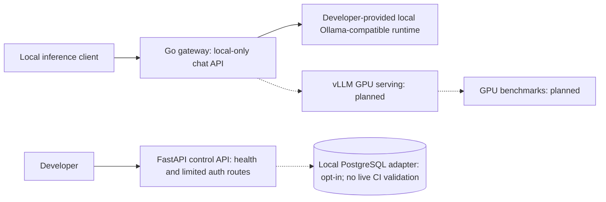

# Metriqen

**LLM Serving & Inference Optimization Platform**

Metriqen is an engineering project focused on deploying open-weight language models under concurrent traffic, then testing quantization, batching, and GPU-memory strategies against an objective baseline.

**Status: local inference tooling plus a developer-operated, consistency-checked real-model serving experiment.** The Go gateway provides a tested local-only OpenAI-compatible inference bridge (including streaming), and the Python runner records repeated local load-test observations. On 2026-10-13 the developer completed two separate nine-run, pinned-model Ollama sweeps on Apple M2 (648 successful measured requests total), separately evaluated 36 reference questions per setting, and ran the strict private evidence comparator. A [public aggregate case study](docs/benchmarks/experiments/2026-10-13-ollama-parallelism.md) records descriptive performance changes; raw reports and manifests remain private and were not independently reviewed by GitHub CI. No causal optimization gain, production service or vLLM GPU performance is verified. A read-only control-plane identity endpoint verifies strictly typed access JWTs against a configured, pinned public JWKS. A second read-only project endpoint checks RBAC against server-resolved projects and memberships **only when a trusted backend store is injected**. A SQLAlchemy tenant schema and read-only PostgreSQL adapter exist, verified with SQLite-based CI fixtures. Operator-configured **loopback-only** PostgreSQL can now be opted into at startup; no PostgreSQL server was run in CI, and default startup remains disconnected. The Go inference gateway remains unauthenticated.

## Problem and research goal

Throughput, time to first token (TTFT), p95 latency, GPU memory, and serving cost change with workload concurrency and model/runtime configuration. Our objective is to **measure before and after performance at comparable output quality**, not claim unverified gains.

## Observed local experiment — 2026-10-13

A developer-operated Apple M2 MacBook Air with Ollama 0.30.8, pinned `llama3.2:1b` Q8_0 and the Metriqen Go gateway compared `OLLAMA_NUM_PARALLEL=1` against `2`, using 36 synthetic requests per run, 3 repeats each at client concurrency 1/2/4, and separate 36-question reference checks. **Both configurations completed 324/324 requests with zero failures.**

| Offered concurrency | Requests/s P=1 → P=2 | p95 latency P=1 → P=2 | TTFT p50 P=1 → P=2 |
| --- | ---: | ---: | ---: |
| 1 | 0.1566 → 0.1505 (−3.895%) | 8.966 → 8.801 s | 0.393 → 0.500 s (worse) |
| 2 | **0.1811 → 0.2431 (+34.235%)** | **13.561 → 11.164 s** | **5.940 → 0.654 s** |
| 4 | 0.2101 → 0.2374 (+12.994%) | 21.874 → 20.788 s | 14.251 → 8.513 s |

Exact match remained **31/36** and normalized exact match **33/36**, but these simple reference questions cannot establish broad quality equivalence. The official local tool returned `descriptive_not_causal`; private source reports are not checked by public CI. **This is one sequential, small-sample, local observation, not proof of a general or causal speedup.**

[Read experimental design, all compared metrics, limitations and reproduction](docs/benchmarks/experiments/2026-10-13-ollama-parallelism.md) · [Machine-readable aggregate transcription](docs/benchmarks/experiments/2026-10-13-ollama-parallelism.json)

With the original private report directories still on the developer's Mac, `python3 -m tools.benchmark.audit_public_case_study` can re-run the strict local comparison, hash the checked-in v1 workloads, and check every published numeric aggregate. It does **not** attest the true server configuration, physical device or causality, and GitHub CI still cannot access those private files.

## Implemented

- FastAPI control service: `GET /health/live` and `GET /health/ready`.
- Go gateway process: matching health endpoints and graceful shutdown.
- Unit tests for both services; Go tests run with the race detector.
- Docker Compose configuration that only binds host ports to loopback.
- CI workflow for Python and Go tests.
- Tenant-scoped authorization policy with HTTP project-read enforcement through trusted backend resolution. A PostgreSQL-targeted organization/project/membership/grants schema and SQLAlchemy read-only adapter are implemented, tested with temporary SQLite; default app remains disconnected, but a strict local PostgreSQL DSN can opt the trusted adapter into project reads without automatically migrating tables.
- OIDC RS256 claim verification and trusted in-memory JWKS key selection tests (no live identity provider).
- A fail-closed FastAPI `GET /api/v1/identity` boundary verifies a dedicated `at+jwt` bearer access token against an operator-pinned local public JWKS snapshot; disabled without complete trusted settings. It grants no tenant rights and does not secure Go inference.
- Local-only Go `POST /v1/chat/completions` forwarding to a configured local OpenAI-compatible runtime, including SSE flush, input limits, bounded validated non-streaming responses, concurrency backpressure and cancellation (tested with loopback HTTP mocks).
- A dependency-free local benchmark runner for streamed TTFT, p95 latency, successful throughput, error rates and optional token usage.
- A deterministic concurrency sweep CLI rotates 1/2/4 concurrent requests across repeated local runs, preserves each private report and emits aggregate run-level median/range summaries of throughput, latency p50/p95 and TTFT p50/p95 only when all runs succeed; two operator-run pinned-model v1 sweeps now have privately verified aggregates.
- An offline evidence comparison CLI checks complete baseline and candidate raw reports, matched model/hardware/workload and unchanged quality before reporting descriptive changes; one local before/after comparison is now documented without causal speedup claims.
- New versioned **synthetic starter** evaluation files provide 36 varied-length performance prompts and 36 narrow-answer quality questions, with dataset contract tests. Their sizes do not establish real-model correctness or representativeness.
- An evidence-bundle CLI cross-validates completed run reports, concurrency summary, a separate local answer-quality report and human-provided runtime metadata before creating a non-overwriting manifest. It does not attest actual hardware or execution. SSE framing, in-band errors and truncation are checked before counting a stream as successful; streaming token usage is requested by default and recorded for reproducibility. Offline and cross-service fixture tests; **operator-run nine-run benchmark bundles were verified locally, but source files were not uploaded for independent CI revalidation**.
- NLP evaluation CLI for exact/normalized matching on ID-aligned JSONL, plus a localhost-only tool that obtains model predictions and scores references in memory. Verified with mock responses in CI and run by the developer on 36 local model answers per setting; no semantic or hallucination grading claimed.

**Not implemented:** user/admin login, live-PostgreSQL-verified tenant persistence or production RBAC integration, API-key authentication on inference, identity-provider discovery, independently replicated cross-hardware model benchmarks, vLLM GPU serving, statistically controlled or causally verified serving optimization, quantization experiments, optimization UI, or production deployment. Readiness currently checks the processes only. **Do not expose inference publicly.**

## Develop locally

Prerequisites: Python 3.12+, Go 1.23+ (CI uses Go 1.27.2). Docker is optional.

Control API:

1. `cd services/control-api`
2. `python -m pip install -e '.[dev]'`
3. `uvicorn app.main:app --host 127.0.0.1 --port 8000`

Gateway (in another terminal):

1. `cd services/inference-gateway`
2. `go run ./cmd/server` (health-only default). To connect local Ollama: `METRIQEN_UPSTREAM_URL=http://127.0.0.1:11434 go run ./cmd/server`. See [local inference guide](docs/operations/local-inference.md) for prerequisites, curl commands and security limitations.

From the repository root, run `make test` after installing Python development dependencies. This runs the control API, Go gateway, cross-service E2E, benchmark, and NLP suites. To check local benchmark evidence consistency, use `python -m tools.benchmark.evidence_gate path/to/manifest.json --verify-reports`; the check does not establish actual model execution.

With Docker Engine, use `docker compose up --build` for local-only HTTP services. Docker operation must still be verified in an environment with an active Docker daemon.

## Architecture and roadmap

Solid lines are current interfaces; dashed lines are planned components.

See [versioned evaluation workload v1](docs/benchmarks/workload-design-v1.md), [controlled inference comparison protocol](docs/benchmarks/controlled-comparison.md), [local PostgreSQL configuration](docs/operations/tenant-database-schema.md), [ADR-0010](docs/architecture/adr/0010-local-postgresql-runtime-configuration.md), [ADR-0009](docs/architecture/adr/0009-tenant-relational-store.md), [project RBAC HTTP contract](docs/architecture/adr/0008-project-rbac-http-boundary.md), [local control API identity test](docs/operations/pinned-oidc-identity.md), [ADR-0007](docs/architecture/adr/0007-pinned-jwks-http-identity.md), [real-model evidence bundle](docs/benchmarks/real-model-evidence-bundle.md), [repeated local benchmark workflow](docs/benchmarks/repeated-sweep.md), [real-model baseline protocol](docs/operations/real-model-baseline.md), [NLP evaluation guide](docs/nlp-eval/README.md), [end-to-end verification guide](docs/operations/e2e-contract-validation.md), [requirements](docs/product/PRD.md), [roadmap](ROADMAP.md), [security policy](SECURITY.md), [local inference guide](docs/operations/local-inference.md), [local benchmark guide](docs/benchmarks/local-load-testing.md), and [ADR-0004](docs/architecture/adr/0004-local-inference-bridge.md).

## Measurement standards

Every future experiment must record model revision, hardware/VRAM, precision, runtime version, traffic profile, prompt/output lengths, warm-up, concurrency, failures, and quality-evaluation methodology. Report actual measured results only.

## License

No open-source license has been selected yet. A public repository without a license does not grant general reuse rights.
