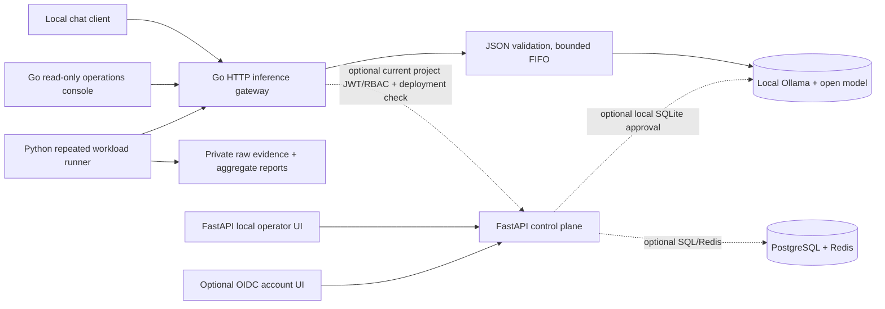

# Metriqen — LLM Serving and Optimization: Engineering Case Study

**Portfolio audience:** AI Infrastructure Engineer · LLM Platform Engineer ·
Machine Learning Systems Engineer · Backend/MLOps Engineer

**Project state:** source-available, tested **local research prototype**.
**Portfolio v1.0 not released.** This case study makes only claims supported
by the repository's existing implementation or explicitly qualified
operator-observed measurements. It does not imply a production SaaS,
GPU-serving framework, a novel LLM inference kernel or real Mac tests in CI.

## The engineering problem

An application calling an open-weight LLM needs more than `ollama run`:
it must validate incoming traffic, handle streaming and cancellation, bound
concurrency, degrade safely on overloaded/failed upstreams, and measure
throughput and user-perceived latency **without confusing the gateway's
queueing with the model's actual execution**. Changes to serving settings
can improve one workload while degrading another, so optimization results
also require workload, hardware and answer-quality controls.

Metriqen explores these trade-offs in a small, verifiable, local-only
system. The design separates a **Go data plane**, an optional
**FastAPI control plane**, and a **Python experiment/evidence plane**.

## Architecture, trust boundaries, and deployment model



All serving URLs are pinned to `127.0.0.1` development listeners.
No public HTTP exposure is supported. The unauthenticated local developer
gateway is distinct from the explicitly opt-in guarded gateway.
The operator model-manager token is **not** an OIDC identity or a
project-scoped Go gateway credential, and approval of a tag in the local
operator registry does not automatically protect direct unguarded Go
inference. The UI cross-console links transfer no credentials or
cross-origin JavaScript requests.

Important implementation boundaries:

- **Data plane:** Go validates chat JSON, requested model and output cap,
  exposes OpenAI-compatible nonstreaming and SSE streaming, limits local
  active requests, optionally FIFO queues requests, and propagates client
  cancellation without exposing upstream error bodies.
- **Control plane:** optional FastAPI, local pinned-digest model approval,
  preload/unload and versioned local deployment rollback, PostgreSQL
  organization/project RBAC and JWT/OIDC browser identity. Redis provides
  optional project rate limiting, in-flight request leases and
  **conservative requested maximum output-token reservations**.
- **Observability:** process-local fixed-schema admission, outcomes,
  upstream-failure and provider-reported token counters. They reset at
  restart. Model-supplied token counts are never trusted billing
  observations; no user prompt/response contents appear in metrics.
- **Evaluation:** repeatable fixed datasets and concurrency sweeps,
  separate quality checks, evidence-manifest validation, comparison tools
  and an operator-sourced preflight gate for a prospective A/B/A/B trial.

See the current [feature and opt-in boundaries](../README.md),
[security model](../SECURITY.md), and
[three-console reviewer tour](operations/portfolio-local-reviewer-journey.md).

## Engineering decision 1 — bounded admission before proxying

The gateway uses four process-local active inference admissions and
optionally a FIFO wait queue of up to 32 requests with a bounded deadline.
Admission capacity is deliberately **not** described as real GPU slots.
Overload can return an explicit HTTP 429 and a short retry hint rather
than queueing requests without a bound. Canceled waiters must be removed
and cannot consume the next admitted slot.

**Trade-off:** this avoids unbounded in-memory waiters, but a FIFO
gateway queue neither implements model-runtime batching nor guarantees
tenant fairness or improves end-to-end inference throughput. Enabling
a queue changes the experimental system: baseline measurements with
queue depth 0 should not be compared to queue-enabled traffic without
explicitly controlling that difference.

**Evidence:** Go race/adversarial scheduler tests and the
[synthetic offline reviewer demo](operations/offline-portfolio-demo.md).
The latter runs the actual Go gateway against a local fake model;
it **does not generate real LLM tokens**.

## Engineering decision 2 — optional security without false defaults

The controller supports pinned-JWKS token verification and authoritative
PostgreSQL organization/project access. In *guarded* mode, the gateway
can invoke the loopback controller to verify `inference.invoke` and
deployment-specific model identity. Redis provides opt-in shared
per-project quota and in-flight limits across replicas; denied/expired
reservations fail closed.

**Trade-off:** runtime model tags can be retagged, a digest check is
point-in-time, and a full declared `max_tokens` reservation can exceed
actual emitted tokens and is intentionally **not refunded** on failures.
Without each operator opt-in configured, the legacy local gateway may
bypass guarded tenant policies; none of this is evidence of production
identity security or exact usage billing.

**Evidence:** Go JWT/SQL authorization, Redis 7 and PostgreSQL
integration jobs in [CI](../.github/workflows/ci.yml),
[security document](../SECURITY.md), and
[operator budget runbook](operations/project-output-token-reservations.md).

## Engineering decision 3 — do not trust provider-side usage claims

Go captures optional `usage.prompt_tokens`, `completion_tokens`
and `total_tokens` fields only for structurally plausible, completed
HTTP responses. The streaming path has strict bounded final SSE
metadata handling, clean terminal `[DONE]`, duplicate/late usage
rejection and an explicitly unmeasured category. The newer read-only
dashboard displays only anonymous aggregate counts and never individual
prompts, model responses, tenant IDs or financial cost.

**Trade-off:** structurally consistent numbers may still be fabricated
by the model runtime; they are *self-reported metrics*, not independently
recomputed token counts or an attested billing ledger.

**Evidence:** [usage semantics](operations/provider-usage-observability.md)
and the provider usage and SSE test suites in
`services/inference-gateway/internal/httpapi/`.

## Real-model experiment — observed configuration trade-offs

On **October 13, 2026**, an operator ran a sequential local
Ollama comparison on an Apple M2, `llama3.2:1b` Q8_0,
Ollama 0.30.8, with nine measured runs per configuration
(three repeats for each of client concurrency 1, 2 and 4).
The change was **Ollama's** `OLLAMA_NUM_PARALLEL` setting, from
1 to 2, **not a new Metriqen scheduling algorithm**.

| Offered concurrency | Baseline RPS P=1 | Candidate RPS P=2 | Observed RPS change | Observed p95 change |
| ---: | ---: | ---: | ---: | ---: |
| 1 | 0.1566 | 0.1505 | **−3.895%** | −1.839% |
| 2 | 0.1811 | 0.2431 | **+34.235%** | −17.679% |
| 4 | 0.2101 | 0.2374 | **+12.994%** | −4.964% |

The **negative result matters**: at concurrency 1, TTFT p50
**increased by 27.025%** and RPS regressed by about 3.9%.
At concurrency 4, two-slot TTFT p50 was still **8.513 seconds**.
Separately evaluated deterministic reference questions matched
**31/36 exact** and **33/36 normalized** in both settings;
those are *not* measures of semantic correctness or general model
quality.

The operator reports **648 successful / 0 failed measured requests**,
but raw reports and local runtime logs are private and cannot be
independently reconstructed from the public repository.
The comparison was not randomized or prospectively repeated A/B/A/B;
thermal state, caches and runtime slots may confound conclusions.
The result is **descriptive, not causal or a production speedup**.
See [full published methodology, per-concurrency results and
limitations](benchmarks/experiments/2026-10-13-ollama-parallelism.md).

## October 20 four-phase replication — why the first speedup did not replicate

A fresh operator-collected **A1/B1/A2/B2** local study of the same Ollama
parallelism setting (1/2/1/2) completed 36 timed runs and
**1,296/1,296 measured requests**, plus 144 narrow reference-quality
completions. Four operator-attested finalizations and the strict private
four-phase evidence-consistency reviewer all returned **PASS**, but those
checks cannot authenticate hardware, live slots, thermals or uninterrupted
AC power.

At offered concurrency 2, B1 gave **0.724 requests/s** versus
A1 **0.302** (+139.79%), yet B2 gave **0.371** versus
A2 **0.402** (**−7.73%**). Same-setting B1→B2 throughput drift was
**−48.69%**. The four phase-specific reference scores were identical
(86.11% exact, 91.67% normalized match), which tests limited string
matching only. B1 has no independently preserved benchmark-time slot
observation; continuous AC for A2 was unverified. The observed candidate
effect is therefore **not reproducible enough to claim a speedup**.

See the [full October 20 aggregate with all concurrency levels, p95/TTFT,
same-setting drift and limitations](benchmarks/experiments/2026-10-20-ollama-parallelism-abab.md).
The October 13 study above remains a **separate historical experiment**,
not additional independent replications of this study.

### October 21, 2026 — Metriqen-owned FIFO admission tradeoff

The operator reported a fresh **real local** depth-0 versus depth-2 Go admission experiment with unchanged configured Ollama parallelism 2, the same pinned `llama3.2:1b` Q8_0 model, and 432 measured requests plus 36 narrow quality checks per condition. The private strict A/B raw-evidence reviewer returned descriptive consistency PASS. Completed requests rose **144/432 → 252/432**; client-observed HTTP 429s fell **288 → 180**. However, **successful goodput fell at each tested C=4/6/8/12**, and successful-only p95 latency and TTFT rose substantially when overloaded. Both phases recorded 31/36 exact and 33/36 normalized reference matches. These are separate experimental results from Ollama's earlier `OLLAMA_NUM_PARALLEL` configurations and the Go CPU parsing microbenchmark. [All four concurrency levels, uncertainty, and adverse tradeoffs](benchmarks/experiments/2026-10-21-fifo-admission-overload.md).

**Interpretation:** B improved observed acceptance under the offered concurrency workload; it did **not** speed up inference. Successful-only latency is biased by heavy baseline rejection, and uncontrolled thermal/temporal drift is a serious confounder. The FIFO queue remains opt-in, there is no causal-speedup claim, and formal P3 acceptance is pending independent private counter/configuration review.

## Metriqen-controlled optimization — CPU-only request parsing

A separate **synthetic hosted Linux Go microbenchmark** compared the
gateway's earlier double JSON model-selection parse with the
single-pass extraction that reuses the already validated model.
In five paired observations, median duration fell from
**25,350 ns/op to 16,258 ns/op**, about **35.9% less CPU-side
model-selection work**, and allocations declined from **65 to 43
allocs/op**.

This is a genuine narrow *Go code-path* optimization and is backed by
adversarial model-value correctness checks and CI, **but it does not
measure or prove an improvement in real model RPS, TTFT, p95, or GPU
memory**. The serving platform still needs a controlled end-to-end
before/after run before a real inference-performance claim is made.
See [exact microbenchmark and scope](benchmarks/experiments/2026-10-18-model-selection-cpu.md).

## Reproduce the evidence, honestly

**Synthetic, no real LLM download or generation:**

```sh
python3 -m tools.demo.offline
```

The expected `demo_kind` is `synthetic_gateway_contract_demo` and
the report explicitly says `model_inference_executed: false`.
This demonstrates real gateway contracts only.

**Real Mac-only acceptance, performed by the machine operator:**

```sh
# With Ollama and the Go gateway already running on loopback:
python3 -m tools.demo.real_ollama \
  --model llama3.2:1b \
  --expected-digest YOUR_LOCAL_VERIFIED_64_CHARACTER_DIGEST \
  --output reports/local/real-ollama-smoke.json
```

This operation has **not** been run from GitHub CI or by the
assistant on the operator's Mac. A successful report requires a live
local Ollama and Go gateway, nonempty native and gateway chat, completed
SSE frames, loaded digest and gateway outcome counters. It proves
neither actual Metal computation nor performance gains. See
[real-model operator runbook](operations/real-ollama-portfolio-acceptance.md).

**Prospective A/B/A/B operator benchmark:** four distinct, fully timed
run/quality/evidence directories, one fresh and digest-matched preflight
per phase, correct parallelism 1/2/1/2, and a descriptive report
after validating the [preflight binding gate](benchmarks/phase-preflight-binding.md).
The operator subsequently reported running all four phases on an Apple M2 and obtaining private review PASS on October 20. Human review of runtime-slot/power controls and release acceptance remains outstanding; GitHub CI has not run the real model.

## Current verified engineering evidence versus missing acceptance

| Evidence | Status | What it does *not* prove |
| --- | --- | --- |
| PR #82, merged Go provider usage/reviewer UI | [11/11 post-merge CI success](https://github.com/naim-munshi/metriqen-llm-serving-optimization/actions/runs/39091018921) | Real browser screenshots or Mac Ollama |
| PR #80, real-model local smoke command + tests | [11/11 post-merge CI success](https://github.com/naim-munshi/metriqen-llm-serving-optimization/actions/runs/39089847172); subsequent Mac execution operator-reported | CI alone cannot independently attest the operator's Mac execution |
| October 13 published Ollama experiment | Operator-attested public aggregates | Causality, independent raw-data recomputation, general GPU speedup |
| October 20 four-phase Ollama study | 36 operator-collected timed runs; private consistency PASS; [public descriptive aggregate](benchmarks/experiments/2026-10-20-ollama-parallelism-abab.md) | Reproducible or causal speedup; independent B1-time slots / continuous A2 AC |\n| October 18 Go parsing microbenchmark | Five paired synthetic Linux CI observations | End-to-end serving speedup |
| P1–P6 Portfolio v1.0 release | **Not finished**; see [release gates](PORTFOLIO_V1_ACCEPTANCE.md) | A tagged v1.0 release, hosted product, completed screenshots or authorized public service |

## What to discuss in an AI Infrastructure interview

1. Why bounded gateway admission is not GPU batching or model runtime
   parallelism, and how backpressure affects p95 and queue wait.
2. How SSE terminal detection, stream cancellation and a final usage
   report are kept separate from a model's actual generated tokens.
3. Why per-project JWT/RBAC checks, Redis permits, loaded model digest
   checks and local operator approval are distinct trust boundaries.
4. Why a 34% observed RPS increase at concurrency 2 cannot be attributed
   to a new Metriqen algorithm and must be reported with the concurrency
   1 regression.
5. Why a 35.9% faster CPU JSON parser does not automatically improve
   TTFT or LLM throughput; how an A/B/A/B test would verify this.
6. How to reproduce gateway bugs with a deterministic fake upstream,
   Go race tests and real ephemeral Redis/PostgreSQL CI without
   pretending the runner executes a GPU model.

**Finish line:** [all six evidence-based acceptance gates](PORTFOLIO_V1_ACCEPTANCE.md)
plus a sanitized real operator demo and controlled benchmark.
No `v1.0.0` GitHub release or screenshot is claimed until those exist.
